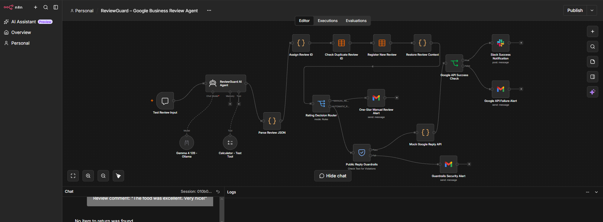
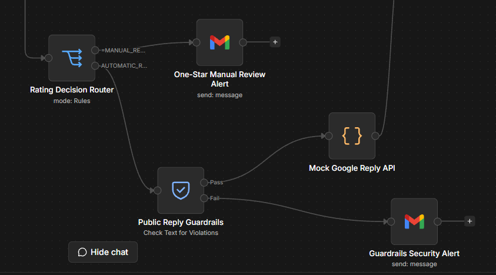
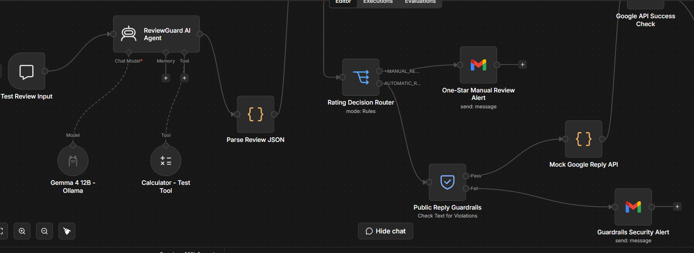
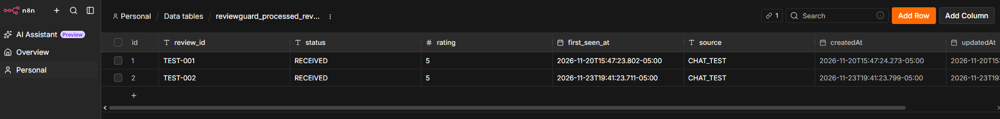
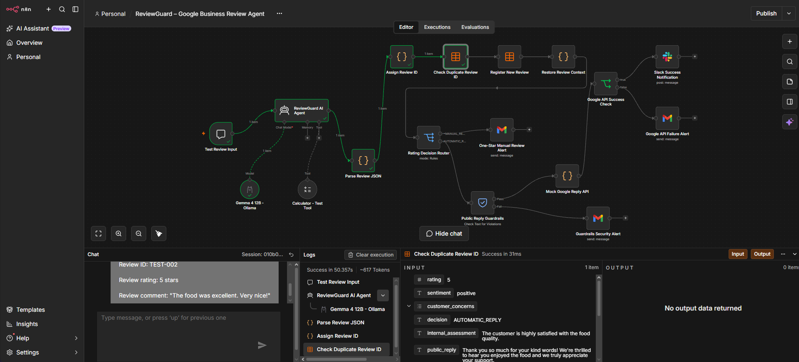
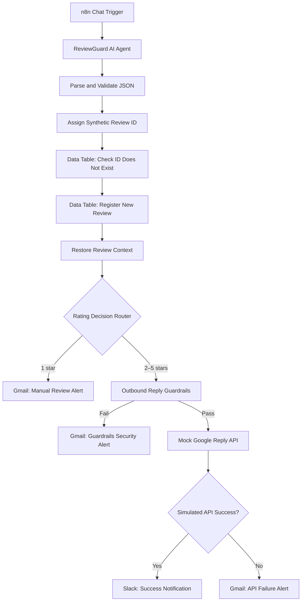

# ReviewGuard — AI-Powered Business Review Management (Prototype)

ReviewGuard is a local, AI-assisted business-review management prototype built with **n8n**, **Ollama**, and **Gemma 4 12B**. It demonstrates how a workflow can classify incoming review feedback, draft rating-appropriate responses, apply outbound-content guardrails, detect duplicate review IDs, and notify an operator through Gmail and Slack.

> **Prototype status:** This repository contains a test workflow. It uses an n8n chat trigger and a simulated Google Business Profile reply operation. It does **not** connect to Google Business Profile, create a public business listing, read live reviews, or publish public replies.

## Screenshots

The screenshots below show the local prototype and its manually tested paths. Review content and review IDs are synthetic. The Google Business Profile operation is simulated; no public reply is sent.

### 1. End-to-end workflow



The complete n8n workflow, from chat-based test input through classification, duplicate detection, rating-based routing, outbound guardrails, and notifications.

### 2. Rating-based routing



The one-star manual-review path is separate from the automated test path for ratings of two to five stars.

### 3. AI agent and outbound security guardrails



Gemma runs locally through Ollama. The generated reply passes through n8n Guardrails before reaching the simulated reply node.

### 4. Review tracking Data Table



The Data Table stores synthetic review IDs and their initial processing metadata.

### 5. Duplicate review rejection



The second sequential submission of `TEST-002` stops at **Check Duplicate Review ID**. The node returns zero output items, so the downstream registration and reply-notification path does not run again.

## What it demonstrates

- Local LLM inference through Ollama using `gemma4:12b`.
- AI-assisted review classification and concise response drafting.
- A deterministic rating policy enforced by workflow code:
  - **1 star:** send a manual-review alert; do not create an automatic public reply.
  - **2–5 stars:** draft a response for the simulated automatic-reply path.
- JSON parsing and validation before routing.
- Persistent review-ID lookup and registration using an n8n Data Table.
- Outbound text checks for personal data, secret keys, and URLs using n8n Guardrails.
- Gmail notifications for one-star reviews, blocked replies, and simulated API failures.
- Slack notification only when the simulated Google API operation reports success.
- Testable success and failure modes (simulated HTTP 200 and HTTP 503).

## Architecture



### Workflow components

| Component | Responsibility |
|---|---|
| Test Review Input | Receives synthetic review text through the n8n chat interface. |
| ReviewGuard AI Agent | Uses Gemma to classify the review and draft a response according to the rating policy. |
| Parse Review JSON | Parses the model output, validates the 1–5 rating, and enforces the routing decision. |
| Assign Review ID | Extracts the synthetic `Review ID:` value from the chat message and adds metadata. |
| Check Duplicate Review ID | Continues only when the review ID is not already in the Data Table. |
| Register New Review | Inserts the new ID and its initial metadata into the Data Table. |
| Restore Review Context | Recombines the inserted row with the AI analysis required by downstream nodes. |
| Public Reply Guardrails | Checks the proposed outbound reply for PII, secret keys, and URLs. |
| Mock Google Reply API | Simulates a reply operation; it never calls Google. |
| Google API Success Check | Sends successful simulations to Slack and failed simulations to Gmail. |

## Technology stack

- **n8n** — workflow orchestration and self-hosted automation.
- **Docker Desktop** — runs the n8n container.
- **Ollama** — local model-serving runtime.
- **Gemma 4 12B (`gemma4:12b`)** — local chat model used by the AI Agent.
- **n8n Data Tables** — persistent storage for processed test review IDs.
- **Gmail** — operator alerts.
- **Slack** — simulated-success notifications.

The workflow was developed and tested in a self-hosted n8n environment shown as version **2.37.10** in its execution metadata. Exact node options and import behavior can vary across n8n versions.

## Prerequisites

1. Docker Desktop with a running self-hosted n8n instance.
2. Ollama installed and running on the host machine.
3. The model available in Ollama:

   ```powershell
   ollama pull gemma4:12b
   ollama list
   ```

4. Gmail and Slack credentials configured inside n8n.
5. An n8n Data Table created as described below.

### Ollama connection from Docker Desktop

When n8n runs inside Docker Desktop on Windows and Ollama runs on the Windows host, configure the n8n Ollama credential to use:

```text
http://host.docker.internal:11434
```

This is the host address that was successfully tested from the n8n container in the development environment. Do not use `localhost` from inside the n8n container to reach an Ollama process running on the Windows host.

## Import and configure the workflow

1. In n8n, import [`workflows/reviewguard-workflow.json`](workflows/reviewguard-workflow.json).
2. Open the **Gemma 4 12B - Ollama** node and configure its Ollama credential/connection for `http://host.docker.internal:11434`; confirm the model is `gemma4:12b`.
3. Configure a Gmail credential and select it in each Gmail notification node.
4. Replace the notification-email placeholder in the three Gmail nodes with an address you control. Do not commit your real address to this public repository.
5. Configure a Slack OAuth2 credential, select a destination channel, and verify that the bot/app can post there. Do not commit OAuth tokens, client secrets, or channel identifiers.
6. Recreate the n8n Data Table named `reviewguard_processed_reviews` with these columns:

   | Column | Type |
   |---|---|
   | `review_id` | String |
   | `status` | String |
   | `rating` | Number |
   | `first_seen_at` | Date |
   | `source` | String |

   n8n also manages its own row ID and created/updated timestamps.

7. Open **Check Duplicate Review ID** and **Register New Review** and select the newly created Data Table in each node. Data Table references are instance-specific and must be reselected after importing into another n8n instance.
8. Save the workflow and run the test cases below.

The exported workflow intentionally does not include usable Gmail/Slack credentials or a portable Data Table binding. Each user must configure their own credentials and table locally.

## Run a test review

Use the n8n chat panel and include all three fields. The `Review ID:` label is required by the `Assign Review ID` code node.

```text
Review ID: DEMO-001

Review rating: 5 stars

Review comment:
"The service was excellent. I had a wonderful experience!"
```

Use a **new synthetic ID** for each new-review test. Reusing an ID already stored in the Data Table intentionally causes the duplicate-check node to stop the item.

### Test scenarios

| Scenario | Test input/configuration | Expected behavior |
|---|---|---|
| One-star review | Rating 1 with a synthetic ID | Manual-review Gmail alert; no automatic public reply. |
| Clean 2–5 star review | Rating 2, 3, 4, or 5 with a new ID | Guardrails pass, mock API returns success, Slack receives a test notification. |
| Duplicate review | Submit the same `Review ID:` twice | Second execution stops at the duplicate lookup; no second downstream reply/notification path. |
| Guardrails block | Temporarily inject synthetic PII into the proposed reply in the parsing/test code path | Guardrails Fail branch sends a Gmail security alert; restore the original code immediately afterward. |
| Simulated API failure | Change `MOCK_MODE` in **Mock Google Reply API** from `"success"` to `"failure"` | Simulated HTTP 503; Gmail failure alert; no Slack success notification. |
| Simulated API success | Set `MOCK_MODE` back to `"success"` | Simulated HTTP 200; Slack success notification; no API failure email. |

**PII test safety:** Use only fictional test values such as `test@example.com` and a reserved example telephone number. Do not paste real customer information into test messages or public screenshots. Restore any temporary test-code modification after the test.

## Security and privacy notes

- The committed workflow is a sanitized export. Recheck every export before publishing changes.
- Never commit `.env` files, n8n database/volume contents, execution logs, OAuth tokens, API keys, client secrets, or credential backups.
- Configure Gmail and Slack credentials inside your own n8n instance; do not put secrets in workflow expressions or node text fields.
- Review screenshots for email addresses, workspace/channel names, IDs, review content, and other identifying data before committing them.
- Use synthetic reviews and synthetic review IDs in this repository.
- The current Guardrails node checks the **generated public reply**. It does not independently screen the original incoming review for prompt injection.

## Known limitations

This is a portfolio prototype and is not production-ready. In particular:

1. **No live Google integration:** `Mock Google Reply API` returns simulated results only. `google_reply_published` remains `false`.
2. **Chat input only:** the workflow uses an n8n Chat Trigger, not a Google Business Profile review event trigger.
3. **Duplicate check runs after model inference:** duplicate submissions still invoke Gemma before their ID is checked.
4. **Sequential duplicate test only:** the check-then-insert pattern has been tested sequentially; it does not guarantee atomic protection against simultaneous duplicate arrivals.
5. **Lifecycle is incomplete:** new rows are inserted with status `RECEIVED`; downstream status updates and a full retry lifecycle are not implemented.
6. **No incoming-review prompt-injection guardrail:** the current Guardrails node protects the generated reply, not the original review prompt.
7. **No live publishing or retry mechanism:** real Google API authentication, publication, rate-limit handling, and safe retries are outside this prototype.

Do not connect this workflow to a real business or enable public review replies without implementing and testing the missing production controls, obtaining the required Google API access, and validating the applicable platform policies.

## Repository structure

```text
reviewguard-n8n-ai-review-agent/
├── README.md
├── .gitignore
├── workflows/
│   └── reviewguard-workflow.json
├── docs/
│   ├── architecture.md
│   └── testing-results.md
└── screenshots/
    ├── 01-full-workflow.png
    ├── 02-review-routing.png
    ├── 03-ai-security-guardrails.png
    ├── 04-review-tracking-data-table.png
    ├── 05-duplicate-rejection-execution.png
    └── README.md
```

## Future improvements

- Integrate the official Google Business Profile review API and event/polling mechanism.
- Move duplicate detection ahead of LLM inference.
- Add atomic/idempotent processing and concurrency-safe duplicate prevention.
- Track review states such as `RECEIVED`, `MANUAL_REVIEW_REQUIRED`, `BLOCKED_GUARDRAILS`, `SIMULATED_SUCCESS`, and `FAILED`.
- Add safe retry handling and operational monitoring.
- Screen incoming review text for prompt injection and malicious instructions.
- Add automated workflow tests and evaluation cases for model output quality.

## Disclaimer

ReviewGuard is an educational and portfolio demonstration. It is not affiliated with or endorsed by Google, n8n, Ollama, or the Gemma model developers. It does not create, solicit, or publish fabricated public reviews. All sample review IDs and review content should be synthetic.
